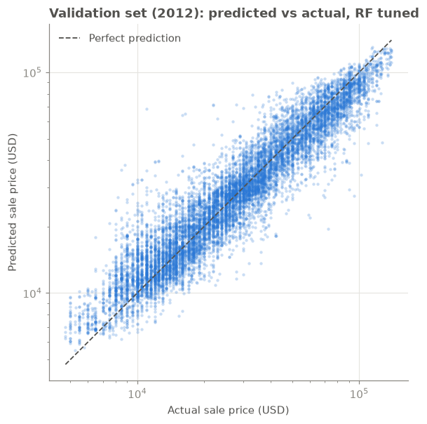
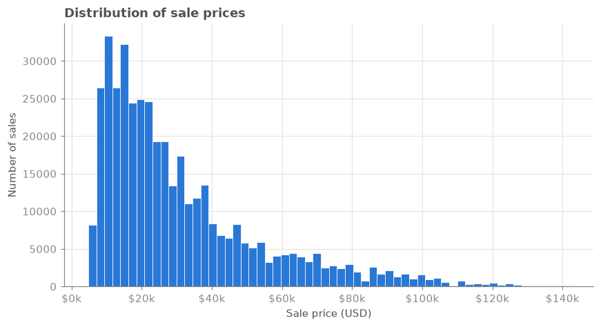
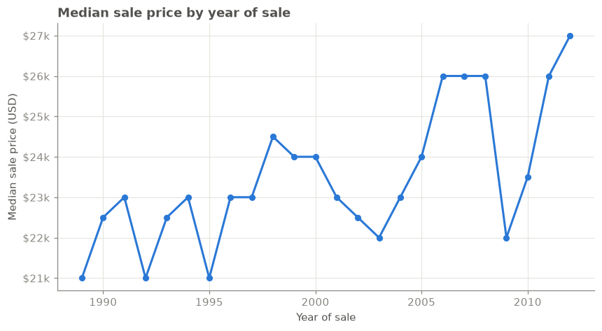
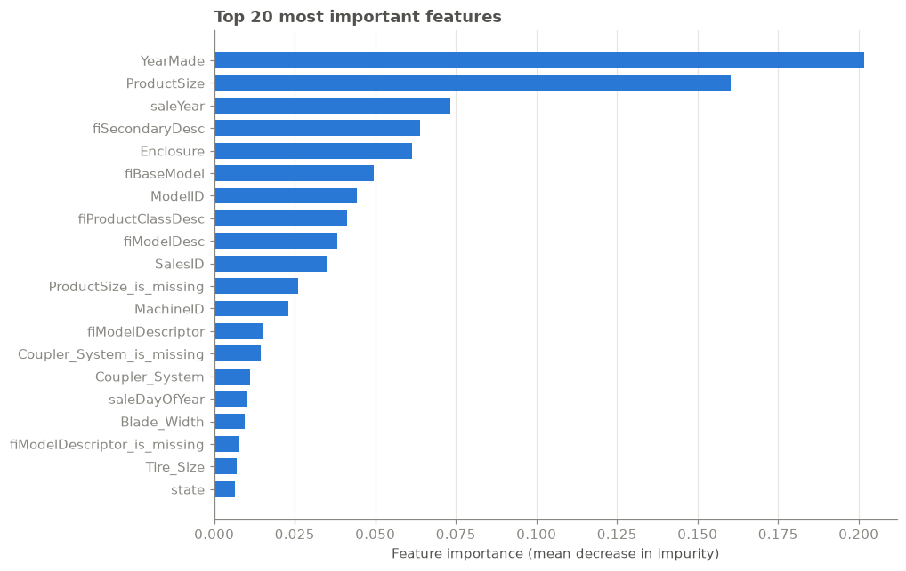

# 🚜 Bulldozer Price Prediction (End-to-End Regression with Random Forest)

Predicts the auction **sale price of used heavy equipment** (bulldozers, excavators, loaders…) from its specs and sale details. It uses the Kaggle [Blue Book for Bulldozers](https://www.kaggle.com/c/bluebook-for-bulldozers/data) dataset: ~412,000 historical auction records from 1989 to 2012.

**Tech stack:** Python · pandas · NumPy · scikit-learn · Matplotlib · Jupyter

---

## 📌 Results

| Model | Validation RMSLE ↓ | Validation MAE ↓ | Validation R² ↑ | Train RMSLE |
|---|---|---|---|---|
| Median baseline (always predict the median price) | 0.744 | $19,697 | −0.18 | – |
| Random Forest, default settings | 0.257 | $6,140 | 0.871 | 0.084 |
| **Random Forest, tuned (final model)** | **0.243** | **$5,917** | **0.882** | 0.143 |

*Validation = the first four months of 2012 (11,573 sales), which the model never saw during training.*

- The tuned model has **67% lower RMSLE** than the median baseline and explains **88% of the variance** in price.
- On average its predictions are about **$5.9k** off, on machines that sell for a median of $24k.
- Tuning **reduced overfitting**: the gap between train and validation RMSLE shrank from 0.17 to 0.10, validation error improved, and training was about 4× faster (41s vs 162s).



---

## 📂 Project structure

```
bulldozer-price-prediction/
├── bulldozer_price_prediction.ipynb   # the whole pipeline, start to finish
├── data/                              # Kaggle CSVs (not committed, see "How to run")
│   ├── TrainAndValid.csv
│   ├── Test.csv
│   └── Data Dictionary.xlsx
├── images/                            # charts saved by the notebook
├── predictions/test_predictions.csv   # final output: SalesID, SalePrice
├── requirements.txt
└── README.md
```

---

## ▶️ How to run

```bash
# 1. Install dependencies
pip install -r requirements.txt

# 2. Download the data from https://www.kaggle.com/c/bluebook-for-bulldozers/data
#    and put TrainAndValid.csv and Test.csv in the data/ folder

# 3. Open the notebook and choose "Run All" (about 5–10 minutes)
jupyter notebook bulldozer_price_prediction.ipynb
```

---

## 🔄 How the project works, start to end

The project follows a standard ML workflow:

```
Problem → Data → EDA → Feature engineering → Time-based split → Preprocessing
       → Baseline → Model → Tuning → Evaluation → Feature importance → Final predictions
```

### 1. Problem definition
**This is a supervised regression problem:** given a machine's features (model, year made, size, hours used, enclosure, state of sale…), predict a continuous number, its `SalePrice`.

The business use: an equipment marketplace or dealer wants to know what a machine is worth *before* it goes to auction.

### 2. Data
| File | What's in it |
|---|---|
| `TrainAndValid.csv` | 412,698 sales from 1989 to April 2012, **with** prices |
| `Test.csv` | 12,457 sales from May to November 2012, **without** prices (the ones we predict) |

There are 53 columns. Most are **text categories** (e.g. `ProductSize = "Medium"`, `Enclosure = "EROPS w AC"`), and many are **mostly empty**: some are more than 90% missing.

### 3. Evaluation metric: RMSLE
The competition uses **Root Mean Squared Log Error**:

```
RMSLE = sqrt( mean( (log(1 + predicted) − log(1 + actual))² ) )
```

**Why a log metric?** It measures **relative** error. Being $5k off on a $10k machine (50% wrong) is much worse than $5k off on a $200k machine (2.5% wrong). Prices range from about $4k to $140k+, so a plain RMSE would be dominated by the expensive machines. Lower RMSLE is better.

I also report **MAE** (average error in dollars) and **R²** (share of the variance in price explained), because they're easier to explain to non-technical people.

### 4. Exploratory data analysis (EDA)
- **Price is right-skewed:** most machines sell for $10k–$40k, with a long tail of expensive ones. That's another reason for a log-based metric.
- **Prices change over time**, so the model must be tested on *future* data, not on a random sample.
- **Data-quality issue:** `YearMade` uses `1000` as a placeholder for "unknown". Tree models handle this on their own, but I documented it.
- **Missing values everywhere:** e.g. `MachineHoursCurrentMeter` is about 64% missing.

| | |
|---|---|
|  |  |

### 5. Feature engineering: dates
A raw date like `2006-11-16` isn't directly useful to a model. I split `saledate` into **`saleYear`, `saleMonth`, `saleDay`, `saleDayOfWeek`, `saleDayOfYear`** and dropped the original. Now the model can learn patterns such as "older machines sell for less" (using `saleYear` together with `YearMade`) and seasonal effects.

### 6. Train/validation split by **time** (not random)
- **Train:** all sales before 2012 (about 401k rows)
- **Validation:** January–April 2012 (about 11.5k rows)

This copies the real situation: you train on the past and predict the future. A random split would let the model "peek" at sales from the same weeks it is tested on, so validation scores would look better than real-world performance.

### 7. Preprocessing: turning everything into numbers
scikit-learn models only accept numbers and can't take missing values, so preprocessing has two steps:

| Column type | What I do |
|---|---|
| **Numeric** (e.g. `MachineHoursCurrentMeter`) | Fill missing values with the **median**, and add a `<column>_is_missing` True/False flag |
| **Text/categorical** (e.g. `state`, `ProductSize`) | Convert to pandas categories and use the **category code**, +1 so that *missing* becomes `0` instead of `-1`. Also add an `_is_missing` flag |

**Why the `_is_missing` flags?** Whether a value is missing can itself carry information. For example, older auction records often lack machine-hour data.

**The leak-free design.** This was the most important bug fix in the project:
- `fit_preprocessor(X_train)` learns the medians and category lists **from training data only**.
- `transform(X, state)` applies **exactly those** medians and categories to training, validation and test data.

If you encode the test set separately, `"Florida"` might become code 8 in training but code 5 in test. The model would silently get the wrong input. Learning only from training data also stops validation data from leaking into training.

### 8. Baseline
Before any ML, I measure a "dumb" model that **always predicts the median training price**. Every real model has to beat this, and it shows how much the ML actually adds.

### 9. Model: Random Forest Regressor
**Why a Random Forest?**
- It's strong on **tabular data** that mixes numeric and categorical features.
- It doesn't need feature scaling and copes with outliers and odd values (like `YearMade = 1000`).
- It averages many decision trees trained on random samples of rows and features, which reduces overfitting compared with a single tree.
- It provides **feature importances**, so the model can be explained.
- It trains fast enough on 400k rows (about 1–2 minutes on a laptop, using all CPU cores via `n_jobs=-1`).

The default model scores much better on training data than on validation data, which means it's **overfitting**: fully grown trees memorise the training data.

### 10. Hyperparameter tuning: `RandomizedSearchCV`
- **Randomized search** tries 30 random combinations of `n_estimators`, `max_depth`, `min_samples_split`, `min_samples_leaf` and `max_features`, instead of every combination (grid search would take hours).
- **`max_samples=10_000`**: during the search each tree sees only 10k rows, so each fit takes seconds instead of minutes.
- **`TimeSeriesSplit` cross-validation**: each fold trains on earlier data and validates on later data. This keeps the time-based logic inside cross-validation too.
- I then retrain with the best settings on the **full** training set and compare the result with the default model. The notebook **picks whichever scores the lower validation RMSLE**, so the choice is driven by data, not assumed.
- **Best settings found:** `max_features=0.5`, `min_samples_leaf=4`, `min_samples_split=6`, `max_depth=None`, retrained with 100 trees on the full data. Considering only half the features at each split and requiring at least 4 samples per leaf makes the trees less able to memorise the training data. That improved validation RMSLE from **0.257 to 0.243**.

### 11. Feature importance


The top features make business sense:
- **`YearMade`** (#1, 20% of importance) **+ `saleYear`** (#3): together they give the machine's **age**, the main driver of depreciation.
- **`ProductSize`** (#2, 16%), **`fiSecondaryDesc`, `fiBaseModel`, `fiProductClassDesc`, `fiModelDesc`**: *what* the machine is. A large dozer is worth far more than a mini excavator.
- **`Enclosure`** (#5): options such as an enclosed, air-conditioned cab add value.
- **`ModelID`**: some models hold their value better than others.
- **`ProductSize_is_missing`** is in the top 20, which shows the missing-value flags carry real signal.

**A note on the ID columns:** `SalesID` (#10) and `MachineID` are just identifiers, yet they rank highly. IDs were assigned over time, so they partly stand in for the date (and may group sales by auctioneer). The model can use them, but they're fragile. Dropping them and checking the validation score would be a sensible next experiment.

### 12. Final model and predictions
Once validation is done, I **retrain on all labelled data** (train + validation, up to April 2012). The test period (May–November 2012) comes right after the validation period, so that recent data is the most useful. I re-fit the preprocessing on the same data, apply it to `Test.csv`, and save `predictions/test_predictions.csv` with columns `SalesID, SalePrice`. A final sanity check confirms that the predicted prices have a realistic distribution: the median predicted test price is **$25.9k** against a historical median of **$24.0k**, and predictions range from $5.3k to $130k against historical prices of $4.8k to $142k.

---

## ⚖️ Design decisions

| Decision | Why |
|---|---|
| **Split by time**, not at random | Prices change over time, and the real task is predicting *future* sales. A random split leaks future information and makes the scores look too good. |
| **Category codes** instead of one-hot encoding | Some columns have thousands of unique values (e.g. `fiModelDesc`). One-hot encoding would create thousands of sparse columns, while tree models split well on integer codes. |
| **Missing-value flags** alongside imputation | Whether a value is missing carries signal: `ProductSize_is_missing` ends up among the top 20 features. |
| **Preprocessing fitted on training data only** | Prevents leakage and guarantees the same encoding for training, validation and test data. |
| **RandomizedSearchCV** instead of GridSearchCV | The search space has more than 10,000 combinations. Random search finds good settings with far fewer fits, and `max_samples` makes each fit faster still. |
| **RMSLE** as the main metric | It measures relative error on a skewed target, so cheap and expensive machines count equally. |

## 🧠 Key takeaways
1. **Validate the way you'll deploy.** This is time-series data, so I split by time, in both the train/validation split and the cross-validation.
2. **Fit preprocessing on training data only, then reuse it everywhere.** This prevents data leakage and keeps category encodings consistent.
3. **Always compare with a baseline** so you know the model adds value.
4. **Pick a metric that matches the business problem.** RMSLE measures relative error.

## 🚀 Possible improvements
- Train on `log1p(SalePrice)` so the model optimises RMSLE directly.
- Try gradient boosting (LightGBM / XGBoost / CatBoost), which usually beats Random Forests on tabular data.
- Add a `machineAge = saleYear − YearMade` feature, clean up `YearMade = 1000`, and use the extra `Machine_Appendix.csv` file.
- Remove low-importance and ID-like columns to make a simpler, faster model.
- Deploy: save the model and preprocessing state with `joblib`, and serve predictions from a FastAPI or Streamlit app.
